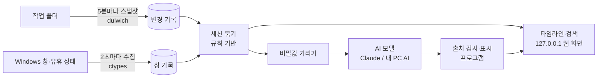

# 작업 기록 앱 — 프로그램 설명자료

_SOLIDEO AX HACKATHON 2026 · 팀 대인배 · 버전 0.1.1 · 2026-11-05 기준_

> **"어제 어디까지 했지?"에 기억 대신 내 작업 기록으로 답해 주는 Windows 앱.**
> 내가 고친 파일을 자동으로 기록해 두고, AI(Claude)가 그 기록만 보고 주간보고·업무일지 초안을 씁니다.
> 문장마다 출처가 붙고, 출처가 맞는지는 AI가 아니라 프로그램이 검사합니다. 기록은 내 PC에만 저장됩니다.

---

## 1. 해결하려는 문제

금요일 오후 주간보고를 쓰려고 하면 "그 일 어디까지 했더라?", "이번 주에 뭐 했지?"부터 떠올려야 합니다.

| 지금 | 왜 문제인가 |
|---|---|
| 한 일의 흔적이 흩어져 있다 | 고친 코드, 메신저, 열어 본 웹페이지, 문서 파일, 그리고 내 기억 |
| 그래서 기억으로 쓴다 | 빠뜨리고, 부풀리고, 매주 같은 시간을 들인다 |
| 일반 AI 챗봇에 물어도 | 내가 한 일은 모른다. 지어낸 내용을 사실처럼 쓸 수도 있다 |
| 시간 측정 앱을 써도 | "어떤 창을 몇 분 띄웠나"만 알 뿐 무엇을 만들었는지는 모른다 |

## 2. 해결 방법: 기록 → 정리 → AI 작성

| 단계 | 하는 일 | AI 사용 |
|---|---|---|
| **1. 자동 기록** | 등록한 작업 폴더를 5분마다 살펴 바뀐 파일과 바뀐 내용을 숨김 Git 저장소에 저장합니다. 코드, 한글(HWP)·워드·엑셀·파워포인트 문서도 텍스트를 뽑아 비교합니다. 어떤 프로그램(창 제목)을 언제 썼는지, 자리를 비운 시간도 함께 기록합니다. | 없음 |
| **2. 정리** | 하루를 앱별·작업 단위(세션)로 묶어 보여 줍니다. 창을 누르면 그때 보던 파일 경로나 웹 주소를 복사할 수 있고, 파일 이름을 누르면 무엇을 바꿨는지(diff) 보여 줍니다. 검색으로 지난 기록을 찾습니다. | 없음 |
| **3. AI 작성** | 주간보고·업무일지 초안을 쓰고, "지난주 GOV-1418 어디까지 했지?" 같은 질문에 기록을 직접 찾아 답합니다. 모든 문장에 출처(고친 파일, 작업 세션)가 붙습니다. | Claude |

1·2단계는 AI 없이 동작합니다. AI는 정리된 기록을 **글로 바꾸는 일**에만 씁니다.

### 화면 구성 (탭 4개)

| 탭 | 내용 |
|---|---|
| 타임라인 | 하루 기록. 앱별 보기(기본)와 세션별 보기. 오른쪽에 그날 고친 파일(결과물 변경) |
| 보고서 (AI) | 주간보고·업무일지 초안 만들기, 문장별 출처, 고쳐서 저장·복사, "보낼 내용 보기" |
| 검색 | 세션 제목·창 제목·고친 파일 검색, "AI에게 묻기" |
| 설정 | 작업 폴더, 기록 대상 앱, 제외 목록, 일시정지·데이터 삭제, 자동 실행, AI 모델 선택 |

## 3. AI 활용

### 3-1. 앱 안의 AI

| 기능 | 동작 |
|---|---|
| **보고서 초안** | 기간 안의 고친 파일(C)과 작업 세션(S)을 보내면, AI가 이슈 번호·MR·작업 폴더를 단서로 일을 묶고 업무별로 실적·다음 계획·이슈를 씁니다. 항목마다 근거 기록의 번호를 함께 돌려줍니다. |
| **AI에게 묻기** | AI가 앱의 **읽기 전용 기록 도구**(기록 검색, 하루 보기 등)를 직접 불러 기록을 찾고, 출처와 함께 답합니다. 앱은 AI가 실제로 부른 도구와 받은 결과를 기록해 두고, 답에 붙은 출처를 그 기록과 맞춰 봅니다. |

**AI 모델:** 설정 → AI 설정에서 고릅니다. 고르기 전에는 AI가 꺼져 있습니다.

| 모델 | 언제 쓰나 |
|---|---|
| **Claude** (PC에 설치·로그인된 Claude Code를 헤드리스로 실행) | 기본. 빠르고 품질이 가장 좋다 |
| 내 PC AI (llama.cpp + Qwen3.5 4B·9B) | 인터넷이 없는 PC. 기록이 PC 밖으로 나가지 않는다 |

AI 코드는 특정 회사 API가 아니라 앱의 공통 인터페이스(`ai_client.Model`)에 맞춰 짰습니다. 모델을 바꿔도 출처 검사·비밀값 가리기·동의·로그는 앱에 그대로 남고, 새 모델은 클래스 하나로 붙습니다.

### 3-2. 핵심 차별점: AI가 쓰고, 프로그램이 검사한다

프롬프트로 "지어내지 마"라고 부탁하는 데서 끝내지 않고, AI의 답을 **코드로 검사**합니다.

| 규칙 | 코드가 하는 일 |
|---|---|
| 없는 출처는 지운다 | AI가 돌려준 출처가 실제로 보낸 기록에 없으면 지웁니다. 물어보기에서는 AI가 도구로 확인하지 않은 출처도 지웁니다. |
| 출처 없는 문장은 표시 | 실적·이슈 문장에 유효한 출처가 없으면 "근거 없음 — 확인 필요"를 붙입니다. |
| "완료"는 내 말이 있을 때만 | "완료·해결·종료"라고 쓴 문장은, 그 출처 중에 **내가 직접 쓴 세션 제목**이 그렇게 말할 때만 그대로 둡니다. 아니면 "완료 근거 없음 — 확인 필요"를 붙입니다. 이슈 번호가 여러 개면 번호마다 따로 확인합니다. |
| 다음 계획은 AI 제안 | 다음 계획은 기록에 없는 내용이므로 모두 "AI 제안 — 확인 필요"로 표시합니다. |
| 빠뜨린 일은 되살린다 | 파일을 고친 작업 폴더가 초안에서 빠지면 "(작업 폴더)" 묶음으로 다시 넣고 경고를 붙입니다. |
| 창만 띄운 건 "했다"가 아니다 | 창 제목은 무엇을 보고 있었는지일 뿐입니다. 실적의 가장 좋은 근거는 실제로 고친 파일입니다. |
| 사람이 저장해야 보고서 | AI 글은 항상 "AI 초안"으로 표시되고, 사용자가 고쳐서 저장해야 보고서가 됩니다. |

출처를 누르면 해당 기록으로 바로 이동합니다(고친 파일은 그 변경 내용이 열립니다).

### 3-3. 개발 과정의 AI

개발 전 과정을 Claude Code로 진행했습니다.

- **코드 작성:** 기능 구현, 리팩터링, 테스트 작성
- **보안 점검:** AI로 취약점을 찾고, 직접 재현한 뒤 고치고 다시 확인
- **품질 시험:** 지어낸 개발자 2주 기록(데모 데이터)으로 AI 보고서를 자동 채점하는 평가 스크립트(`evals/report_eval.py`)를 만들어, 프롬프트나 검사 규칙을 바꿀 때마다 다시 돌림
- **문서화:** 구조·설계·개인정보 문서를 코드와 함께 갱신

## 4. 개인정보와 보안 — 감시가 아니라 나를 위한 기록

| 원칙 | 구현 |
|---|---|
| 내 PC에만 저장 | 기록은 이 PC의 SQLite DB와 숨김 Git 저장소에만 있습니다. 회사로 보내는 기능은 없습니다. 웹 화면은 `127.0.0.1`에서만 열리고 다른 PC에서 접속할 수 없습니다. |
| 내가 고르고, 멈추고, 지운다 | 기록할 업무 앱만 고를 수 있고(나머지는 이름·제목 없이 "업무 외" 시간으로만), 제외 목록·일시정지·기간별 삭제를 지원합니다. |
| 모으지 않는 것 | 키 입력, 클립보드, 화면 캡처, 화면 녹화, 문서 내용 열람, 방문 기록, 마이크·카메라. 웹 주소는 `?` 뒤(토큰·세션값이 있는 곳)를 버리고 저장하며 AI에 보내지 않습니다. |
| 허락해야 AI 사용 | 모델을 고르기 전에는 AI가 꺼져 있습니다. "보낼 내용 보기"로 AI에 보낼 내용을 그대로 미리 볼 수 있습니다. |
| 비밀 정보는 가림 | 비밀번호·인증키·토큰·주민번호·카드번호는 AI에 보내기 전에 `***`로 가립니다. `.env`, 인증서·키 파일 같은 비밀 파일은 스냅샷에 아예 저장하지 않습니다. |
| AI는 읽기만 | Claude는 파일·명령·웹 도구를 모두 끈 상태로, 앱이 주는 읽기 전용 기록 도구만 쓸 수 있습니다. 사용자 설정·훅도 읽지 않는 빈 임시 폴더에서 실행합니다. |
| 로그에도 남기지 않음 | 로그에는 건수·시간·오류 종류만 남기고, 창 제목·메모·검색어·AI 프롬프트와 답은 남기지 않습니다. |

## 5. 기술 구성

| 구분 | 사용한 것 |
|---|---|
| 앱 본체 | Python 3.11+ (표준 라이브러리 위주), SQLite |
| 화면 | HTML · JavaScript (프레임워크·빌드 단계 없음), 한국어 UI |
| 파일 기록 | dulwich (Git 방식, git.exe 설치 불필요, Apache-2.0) |
| 창 기록 | Windows API (ctypes, 추가 패키지 없음), 브라우저 주소는 Windows UI Automation |
| 문서 텍스트 | HWP, DOCX, XLSX, PPTX 직접 추출 |
| AI | Claude Code (헤드리스, 도구 잠금) / llama.cpp + Qwen3.5 (MIT · Apache-2.0) |
| 규모 | Python 모듈 31개(약 5,700줄), 화면 약 1,200줄, 테스트 파일 21개 |

의존성은 상업적 판매가 가능한 라이선스(MIT·BSD·Apache)만 씁니다. GPL 계열 의존성은 없습니다.

## 6. 검증 결과

| 항목 | 결과 | 근거 |
|---|---|---|
| 자동 테스트 | **229개 모두 통과** | `unittest` 전체 실행, 2026-11-05. 기록·세션·검색·AI 검사·보안·배포 스크립트·저장소 흔적 검사 포함 |
| AI 보고서 품질 (Claude) | **8/8 통과**, 지운 출처 0, 경고 0 | `evals/report_eval.py --model claude-code:sonnet --runs 2`, 2026-10-21. 꼭 들어갈 사실 포함, "완료" 부풀림 없음, 다른 날 일 섞임 없음을 채점 |
| 보고서 작성 시간 (Claude) | 한 건 **중앙값 7.4초**, 최대 11.3초 | 같은 측정 |
| AI 보고서 품질 (내 PC AI 9B) | 모든 시험 통과 (GPU 사용) | 2026-10-23 측정. 2026-11-05 프롬프트 변경 후 업무일지 시험 4/4 통과 |
| 보고서 작성 시간 (내 PC AI 9B) | 주간보고 161–221초(GPU), 385–583초(CPU만) | 12세대 Core i5 노트북, 32GB, 보급형 4GB GPU |
| 지어낸 출처 | **0건** | 위 시험 전체에서 검사에 걸려 지운 출처가 없었음. 지어낸 출처가 있더라도 화면에 나오기 전에 프로그램이 지움 |

품질 시험은 모두 지어낸 데모 데이터로 했습니다. 실제 업무 기록은 시험에 쓰지 않았습니다.

**기대 효과 (작성자 경험 기준):** 기억으로 15–20분 걸리던 주간보고를, 초안을 검토하고 고치는 5분 정도로 줄입니다.

## 7. 설치와 사용

1. Releases에서 `WorkHistory-setup.cmd`와 앱 zip을 한 폴더에 받아 setup을 더블클릭합니다. 관리자 권한도, 따로 설치할 것도 필요 없습니다(Python·실행 환경 포함).
2. `작업 기록.cmd`로 켜면 창 없이 뒤에서 기록을 시작하고 브라우저에 앱이 열립니다.
3. 설정은 모두 앱 안에서 합니다. 터미널 작업은 없습니다.
   - 설정 → 작업 폴더: 결과물을 만드는 폴더 등록
   - 설정 → 기록 대상: 업무 앱 고르기
   - 설정 → AI 설정: Claude(이 PC의 Claude Code 로그인 사용) 또는 내 PC AI 선택.
     행망용 zip은 Claude Code 연결을 빼고 만들어 내 PC AI만 보입니다.
4. 체험용 데모: `python -m workhistory --demo`로 지어낸 2주 기록이 담긴 별도 DB를 엽니다(화면 위에 "데모 데이터" 띠 표시).

## 8. 한계와 다음 단계

| 한계 | 다음 단계 |
|---|---|
| Windows 전용 | 사내 개발 PC 기준으로 범위를 좁힌 결정. 수요가 있으면 수집기만 바꿔 확장 |
| Claude를 쓰면 가린 업무 기록이 Claude로 전송됨 | 민감한 환경은 내 PC AI를 고르면 기록이 PC 밖으로 나가지 않음. 모델 연결이 인터페이스 하나로 분리되어 있어 다른 승인 모델로 바꾸기 쉬움 |
| 내 PC AI는 CPU에서 주간보고에 수 분 | 백그라운드 생성(그동안 다른 일), 작은 모델(4B) 선택 |
| 창 제목에 민감한 이름이 보일 수 있음 | 업무 앱만 기록, 제외 목록, 기간 삭제 제공. 기본 제외 목록 보강 |
| 개인 도구 (팀 기능 없음) | 감시 도구가 되지 않도록 의도한 설계. 공유는 사용자가 복사한 보고서로만 |
